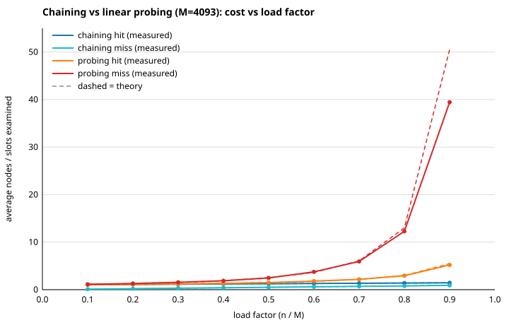
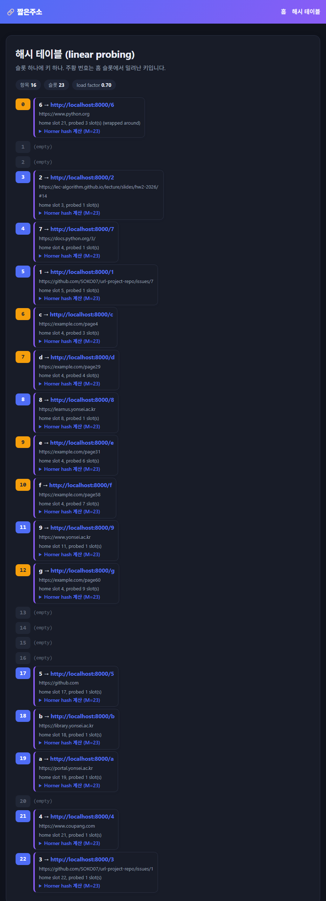

# 과제2 보고서 · URL 단축기

이석호 [20263229]
저장소: https://github.com/SOKO07/url-project-repo

## 1. 구현

- **분리 연쇄:** 슬롯마다 연결 리스트를 둔다. 해시는 Horner 방식 `h = (31·h + 문자코드) mod M`이고, 적재율이 0.75를 넘으면 크기를 `2M+1`로 늘려 다시 넣는다. 에이전트에게 적재율이 낮을 때 크기를 절반으로 줄이는 기능은 없어도 되냐고 물어보니 삭제 기능이 없어서 적재율이 낮아질 일이 없어 구현하지 않았다고 한다.
- **선형 탐사:** 같은 해시로 홈 슬롯을 정하고, 차 있으면 다음 슬롯으로 한 칸씩 간다(마지막 슬롯 다음은 0번). 가득 차면 `TableFullError`를 낸다. 삭제는 지원하지 않는다.
- 두 테이블은 `put/get/find/len/in/load_factor`가 같고, `find`는 비교한 노드 수(연쇄) 또는 살펴본 슬롯 수(탐사)를 함께 돌려준다. 단축기는 어느 쪽이든 받으며, 코드는 URL의 해시가 아니라 일련번호를 base62로 바꾼 값이라 충돌이 없다. `dict`·`set`·내장 `hash()`는 쓰지 않았다.

## 2. 실험 조건과 결과

M = 4093 고정(크기 변경 없음), 같은 키를 두 테이블에 넣고 성공 탐색 2000회·실패 탐색 2000회의 평균을 구했다. 부하율 0.1~0.9, 부하율마다 5회 반복, 시드 2026. 비용은 연쇄는 비교한 노드 수, 탐사는 살펴본 슬롯 수다.

| 부하율 | 연쇄 성공 (이론) | 연쇄 실패 (이론) | 탐사 성공 (이론) | 탐사 실패 (이론) |
| --- | --- | --- | --- | --- |
| 0.5 | 1.25 (1.25) | 0.50 (0.50) | 1.48 (1.50) | 2.46 (2.50) |
| 0.7 | 1.35 (1.35) | 0.70 (0.70) | 2.17 (2.17) | 5.95 (6.06) |
| 0.9 | 1.44 (1.45) | 0.91 (0.90) | 5.21 (5.50) | 39.4 (50.5) |

이론: 연쇄 `1+α/2`, `α` / 탐사 `(1+1/(1-α))/2`, `(1+1/(1-α)²)/2`.
연쇄는 부하율을 4까지 올려도(별도 실험) 이론과 맞았다(성공 3.005, 실패 3.954).

## 3. 해석

연쇄의 비용은 부하율에 비례해 완만하게 늘어난다. 한 슬롯의 리스트 길이는 평균 α일 뿐이라 α가 1을 넘어도 계속 동작한다.
선형 탐사는 충돌한 키가 바로 옆 빈 슬롯을 차지하는데, 그러면 연속으로 찬 구간(군집)이 생기고 이 구간이 커질수록 다른 키의 홈 슬롯이 군집 안에 떨어질 확률이 높아진다.
군집이 군집을 키우는 되먹임이라 비용이 `1/(1-α)²`로 α → 1에서 발산한다. 실패 탐색은 군집 끝의 빈 슬롯까지 가야 해서 성공 탐색보다 훨씬 나쁘다.
0.9에서 연쇄 실패는 0.91, 탐사 실패는 39.4로 40배 이상 차이가 났다. 측정값이 이론 50.5보다 낮은 것은 M이 유한하고 군집 크기의 분산이 커서 평균이 이론값 아래로 치우쳤기 때문으로 본다(반복 5회). 이 부분은 추정이며 반복 횟수를 늘려 확인하지 못했다.

### 3.1 충돌을 직접 만들어 보기 (`/table`)

수업에서 충돌을 구현해 보라고 하셔서, 에이전트에게 선형 탐사 서버(`--table probing`)에 여러 값을 넣어서 충돌나게 해달라고 했다. 나도 이미 url을 몇 개 넣어놔서 그 url들과
에이전트가 넣은 홈 슬롯이 같은 URL을 이용해 충돌을 구현했다. 슬롯 수 M = 23(처음 11에서 적재율 0.75를 넘으며 `2M+1`로 한 번 늘어난 크기)에 16개가 들어 있는 상태(적재율 0.70)에서, Horner 해시 값이 4인 URL 5개(`https://example.com/page4`, `page29`, `page31`, `page58`, `page60`)를 넣었다. 이 URL들은 해시 값이 4가 되는 것을 찾아서 골랐다.

- 4번 슬롯은 이미 `docs.python.org/3/`가 차지하고 있어서, 5개는 차례로 6, 7, 9, 10, 12번에 들어갔다. 살펴본 슬롯 수는 각각 3, 4, 6, 7, 9로, 마지막에 넣은 키는 홈 슬롯에서 9칸을 보고서야 자리를 찾았다. 화면에서 홈 슬롯에서 밀려난 키의 번호는 주황색으로 나온다.
- 3번부터 12번까지 10칸이 빈틈 없이 차서 군집이 만들어졌다. 이 군집에 홈 슬롯이 걸린 키는 모두 군집 끝까지 밀려나므로 군집이 계속 커진다. 3번의 해석이 실제 화면으로 나타난 것이다.
- 홈 슬롯 21번인 `python.org`는 21, 22번이 차 있어 마지막 슬롯에서 0번으로 감겨 들어갔다(화면에 "wrapped around"로 표시, 살펴본 슬롯 3).

## 4. 에이전트가 틀린 곳 / 내가 틀린 곳

실제로 있었던 일은 다음과 같다.

- 1단계에서 에이전트가 처음 쓴 `base62.py`가 글자 → 값 조회용으로 `dict`를 썼다. 명세의 "src/에서 `dict` 금지"를 어긴 것이다. 에이전트가 커밋 전에 스스로 알아채 `str.find`로 고쳤다. 이때는 규칙 파일(5단계)이 아직 없었어서 생긴 일인 것 같다.
- 5단계의 `grep "dict\|set(\|hash("`는 독스트링과 함수 이름 `horner_hash(`까지 걸러서 오탐이 있었다. 결과를 눈으로 읽어 실제 사용이 아님을 확인해야 했다.
- 처음에 핸드폰으로 열리지 않아서 에이전트에게 물어보니 노트북과 핸드폰이 같은 wifi에 접속되어 있어야 한다고 했다. 그래서 핸드폰을 학교 와이파이에 연결했는데도 접속이 막혀서 다시 물어보니 학교나 공용 와이파이는 기기끼리의 연결을 막는 경우도 있다고 해서 노트북을 내 핫스팟에 연결하니 접속됐다.

## 5. 느낀점
- 확실히 실습에서 교수님의 인사이트가 도움이 되었다. 에이전트 활용법도 좋았지만 조금 더 정돈된 환경에서 일을 하는 법을 배웠다. Git에서 이슈를 만들고 브랜치로 세분화해 작업을 하는 식으로 일을 주면 에이전트도 내 지시를 더 잘 따르는 것 같았다. 나는 codespace로 하지 않고 저장소를 클론해 Claude code와 vs code로 작업을 해서 할 수 있는 일이 더 많았던 것 같다. 미리 지시사항을 md 파일에 모아두는 방법도 에이전트에게 컨텍스트를 쌓을 수 있게 해줘 했던 말을 반복하지 않고 토큰도 아낄 수 있어서 자주 활용할 것 같다. 전체적으로 에이전트를 잘 활용하는 것 뿐만 아니라 실제 업무 환경을 경험한 것 같아 엄청 보람차고 의미있는 실습 시간이었다.
